# 🚀 Project 99 – Multi-tenant SaaS Platform | System Design Level | Full Stack DevOps


**Live URL:** https://nine9-multi-tenant-saas.onrender.com/

[](https://nine9-multi-tenant-saas.onrender.com)

Project 99 - Part of Java 102 Projects Challenge - System Design Level Tier 10 SCALE
---
**TIER 10 SCALE 99/102 - 97%**
---

# 📖 Project Overview

**Multi-tenant SaaS Platform** is Project 99 of **Tier 10 – System Design Level – SCALE PROJECT**, developed using **Java 17**, **Spring Boot 3.2.5**, **Spring Cache Caffeine (CaffeineCacheManager maximumSize=1000 expireAfterAccess=600s recordStats() - Redis pattern ready)**, **Security Headers (SecurityHeadersConfig WebMvcConfigurer + HandlerInterceptor X-Content-Type-Options nosniff + X-Frame-Options DENY + X-XSS-Protection)**, **Design Patterns (Builder Pattern TenantData.Builder Fluent API + Strategy Pattern Tenant vs Shared vs Isolated vs Hybrid + Repository Pattern JpaRepository + Caching Pattern Cache-aside)**, **Spring Data JPA**, **H2 Database tenantdb + view_count + idx_tenant + idx_category index**, **JUnit 5 + Mockito 6 tests Green Bar**, **Docker Multi-Stage (maven:3.9-eclipse-temurin-17 + eclipse-temurin:17-jdk-alpine + mkdir -p data)**, **Maven**, and **Apache Tomcat 10.1.20** in a **production System Design ready repo**.

Spring Boot REST API running on port 8101 locally (10000 on Render) with 12 endpoints + home `GET / returns live JSON {"project":"99-multi-tenant-saas","status":"Live - Multi-tenant SaaS - Tier 10 Scale","tier":"10 - System Design Level - Caching + Security + Testing + Design Patterns","caching":"Caffeine Cache - tenantDatas cache - 1000 max, 600s expire - Stats enabled - Redis ready","multi-tenant":"Multi-tenant Pattern - Tenant Shared Isolated Hybrid"}`, `GET /health -> {"status":"UP","cache":"Active - Caffeine - tenantDatas, tenantData - Stats enabled","security":"Headers Active","multi-tenant":"Active - Multi-tenant Pattern - Tenant Shared Isolated Hybrid - Strategy Pattern"}`, `POST /api/tenant-data?tenantId=tenant1&dataId=data1&dataName=Laptop Data&category=Electronics&dataValue=4.8&isolationLevel=isolated -> 200 OK {id, tenantId, dataId, dataName, category, dataValue, isolationLevel, viewCount, createdAt, value}`, `GET /api/tenant-data -> List TenantData with viewCount + X-Cache: Caffeine`, `GET /api/tenant-data/strategy/tenant1?type=tenant -> Tenant-Strategy count 3 + isolationLevel isolated shared hybrid`, `GET /api/tenant-data/strategy/tenant1?type=shared -> Shared-Strategy count 1 + isolationLevel shared`, `GET /api/tenant-data/strategy/tenant1?type=isolated -> Isolated-Strategy count 1 FIXED from [] empty -> trim() fix + isolationLevel isolated`, `GET /api/tenant-data/strategy/tenant1?type=hybrid -> Hybrid-Strategy count 3 sorted by dataValue 4.8 4.5 4.2 + X-Strategy: Hybrid-Strategy`. This repo contains **TenantData.java Entity with Builder inner class**, **TenantDataRepository.java**, **TenantDataService.java**, **CacheConfig.java**, **SecurityHeadersConfig.java**, **TenantDataController.java**, **TenantDataServiceTest (JUnit 5 + Mockito 6 tests green)**. One `git push` gives full Multi-tenant SaaS live.

This is Project 99 of Tier 10 - SCALE - After Recommendation Engine (98), now real System Design base for Audit Log (100).

**Bug Fixed:** `Syntax error in SQL statement "create table tenant_data (... value float ...) expected "identifier""` - H2 reserved keyword `value` - Fixed by renaming field to `dataValue` with `@Column(name="data_value")` + backward compat `getValue()/setValue()` alias - Same pattern as 97 98 value fix.

**Bug Fixed:** `GET /api/tenant-data/strategy/tenant1?type=isolated returns [] empty but DB has Laptop Data isolated` - Postman Enter adds `\n` newline - `isolationLevel="isolated\n"` - Filter `"isolated".equals("isolated\n")` fails - Fixed by adding `trim()` in `createTenantData()` `cleanIsolation=isolationLevel.trim()` + `getTenantDataByStrategy()` `cleanType=type.trim()` + `d.getIsolationLevel().trim()` - BUILD SUCCESS 10.459 sec - Now demo11 returns 1 item CLEAN not [] - CRITICAL FIX - Same as 97 isFuzzyMatch fix count 0->1.

**Bug Fixed:** `Cannot load driver class: org.h2.Driver` - H2 scope runtime - Fixed by removing `<scope>runtime</scope>` + Maven Update Project + Force Update - Same pattern as Tier 9 H2 fix - 94 + 95 + 96 + 97 + 98 also.

**Bug Fixed:** `Unable to resolve name [org.hibernate.dialect.H2Dialect ] as strategy` - Extra newline space in application.properties - Fixed by removing `spring.jpa.database-platform` + `spring.datasource.driverClassName` lines - BUILD SUCCESS 10.459 sec.

**Bug Fixed:** `URL must start with 'jdbc'` - Typo `dbc:h2:mem:tenantdb` missing `j` - Fixed by correcting to `jdbc:h2:mem:tenantdb` - BUILD SUCCESS 10.459s Tier 10.

**Bug Fixed:** `TenantDataController.java red errors - cannot find symbol Cacheable, CaffeineCacheManager` - META-INF folder bug - Eclipse creates `src/main/resources/META-INF` breaking Maven + Maven dependencies not downloaded - Fixed by deleting META-INF + deleting target + Maven Update Project Force Update - Same as 93/94/95/96/97/98 META-INF bug.

**Bug Fixed:** `docker.io/library/openjdk:17-jdk-slim: not found` - OpenJDK image deleted from Docker Hub - Fixed by changing to `eclipse-temurin:17-jdk-alpine` - Render Deploy failed - Same as 94 + 95 + 96 + 97 + 98.

**Bug Fixed:** `COPY target/*.jar app.jar ERROR: lstat /target: no such file or directory` - Docker build doesn't run mvn package - Fixed by using Multi-Stage Dockerfile `FROM maven:3.9-eclipse-temurin-17 AS build + COPY pom.xml + COPY src + RUN mvn clean package -DskipTests + FROM eclipse-temurin:17-jdk-alpine + mkdir -p data + COPY --from=build /app/target/*.jar app.jar` - Deploy succeeded Live 2m38s - Same as 94 + 95 + 96 + 97 + 98.

**Bug Fixed:** `POST /api/tenant-data -> 400 Bad Request` - Query Params empty - Fixed by setting Params tab in Postman Key Value tenantId dataId dataName category dataValue isolationLevel - Same as 97 98 index bug - Now 200 OK id 1 viewCount 0 - 300 ms 587 B - CLEAN without \n.

**Bug Fixed:** `GET /api/tenant-data/strategy/tenant1?type=isolated -> [] empty` - Used `equals` without trim but isolationLevel has `\n` - Fixed by adding `trim()` in Service - Same as 98 content bug - Now 200 OK count 1 Isolated-Strategy - FIXED from [].

**Bug Fixed:** `Was 2/2 tests Tier 5 - Not Tier 10 compliant + UnnecessaryStubbingException` - Only Entity + Format tests - No Builder + No Mockito + No Caching + No Security + No CONTRIBUTING.md - Stubbing both `findAllByOrderByCreatedAtDesc` and `findAll` in testGetAllTenantData_Mockito - Fixed by removing `when(repository.findAll())` + rebuilding to Tier 10 SCALE - Caffeine 1000 max 600s Stats + Security Headers + Builder Pattern + Strategy Pattern Tenant vs Shared vs Isolated vs Hybrid + Repository + Caching + JUnit5 Mockito 6 tests Green Bar Runs: 6/6 Errors: 0 Failures: 0 + viewCount + idx_tenant + idx_category + CONTRIBUTING.md 12466 chars + Issues + 18 Badges + Architecture Diagram + Live Link + Docker Multi-Stage + Render Live 2m38s - Roadmap 100% Compliant.

---

# ✨ Features

- Scale Ready status API with JSON response - `{"project":"99-multi-tenant-saas","status":"Live - Multi-tenant SaaS - Tier 10 Scale","tier":"10 - System Design Level - Caching + Security + Testing + Design Patterns","caching":"Caffeine Cache - tenantDatas cache - 1000 max, 600s expire - Stats enabled - Redis ready","multi-tenant":"Multi-tenant Pattern - Tenant Shared Isolated Hybrid"}`
- Fully production Multi-tenant SaaS API service - 12 endpoints + home + health + tenant-data create + list + tenant + category + search + strategy tenant shared isolated hybrid + count + info + Live on Render Docker - Deploy succeeded 2m38s - Same as 98 Live 2m23s
- Caching - System Design core - `CacheConfig.java @Configuration @EnableCaching` + `CaffeineCacheManager maximumSize=1000 expireAfterAccess=600s recordStats()` + `@Cacheable("tenantDatas") + @Cacheable("tenantData") + @CacheEvict(allEntries=true)` + Headers `X-Cache: Caffeine - tenantDatas` + `Cache-Control: public max-age=3600` + Redis pattern ready + `recordStats` enabled
- Security Headers - `SecurityHeadersConfig.java @Configuration implements WebMvcConfigurer` + `X-Content-Type-Options: nosniff + X-Frame-Options: DENY + X-XSS-Protection: 1; mode=block` + Validation @NotBlank + tenantId empty check
- Builder Pattern - `TenantData.java` - Inner Builder - `TenantData.Builder tenantId() dataId() dataName() category() dataValue() isolationLevel() viewCount() createdAt() build()` Fluent API - No telescoping constructor - `createTenantData` uses Builder + CacheEvict + trim() fix
- Strategy Pattern - `TenantDataService.getTenantDataByStrategy()` + `TenantDataController` - Tenant vs Shared vs Isolated vs Hybrid - `GET /api/tenant-data/strategy/tenant1?type=tenant -> Tenant-Strategy count 3`, `GET /api/tenant-data/strategy/tenant1?type=shared -> Shared-Strategy count 1 + isolationLevel shared`, `GET /api/tenant-data/strategy/tenant1?type=isolated -> Isolated-Strategy count 1 FIXED from [] empty -> trim() fix`, `GET /api/tenant-data/strategy/tenant1?type=hybrid -> Hybrid-Strategy count 3 sorted by dataValue 4.8 4.5 4.2 + X-Strategy: Hybrid-Strategy` - Core Multi-tenant System Design - SaaS Isolation
- Repository Pattern - `TenantDataRepository.java extends JpaRepository<TenantData, Long>` + `findAllByOrderByCreatedAtDesc() + findByTenantIdOrderByCreatedAtDesc() + findByCategoryContainingIgnoreCase() + findByIsolationLevel()` + `idx_tenant` + `idx_category` + `viewCount`
- Caching Pattern - `CacheConfig + @Cacheable + @CacheEvict` - Cache-aside - Stats enabled - Redis ready
- TenantData Entity - `TenantData id Long + tenantId + dataId + dataName + category + dataValue + isolationLevel + viewCount + createdAt + value alias + Builder inner class` - H2 tenantdb + data_value column fix
- Create Logic - `TenantDataService.createTenantData(tenantId, dataId, dataName, category, dataValue, isolationLevel) -> trim() fix cleanIsolation=isolationLevel.trim() -> Builder Pattern -> repository.save + CacheEvict + Return TenantData` - Production create - `POST /api/tenant-data?tenantId=tenant1&dataId=data1&dataName=Laptop Data&category=Electronics&dataValue=4.8&isolationLevel=isolated -> 200 OK {id:1, tenantId, dataId, dataName, message: Created - Builder Pattern, isolationLevel: isolated CLEAN without \n, createdAt: 2026-11-04T00:38:22.613103, viewCount:0, dataValue:4.8, value:4.8}`
- Multi-tenant Logic - `getTenantDataByStrategy(tenantId, type) -> cleanType=type.trim().toLowerCase() -> If type tenant -> allData -> If shared -> filter isolationLevel shared + trim() -> If isolated -> filter isolated + trim() FIXED [] bug -> If hybrid -> sorted by dataValue DESC 4.8->4.5->4.2` - Real multi-tenancy - `tenant1` returns 3 docs hybrid sorted 4.8 then 4.5 then 4.2 - tenant1 cannot see tenant2
- H2 Database - `jdbc:h2:mem:tenantdb FIXED from dbc typo + ddl-auto=create-drop + tenant_data table id category created_at data_id data_name data_value isolation_level tenant_id view_count + index idx_tenant + idx_category + H2Console enabled` - In-memory
- Multi-tenant Pattern - `Tenant all data + Shared only shared isolation + Isolated only isolated isolation FIXED from [] empty + Hybrid sorted by dataValue DESC` - `isolation: Multi-tenant-Pattern - tenant shared isolated hybrid + trim() fix` - For Project 100 Audit Log
- JUnit 5 + Mockito Tests - `TenantDataServiceTest` - 6 tests green - `testBuilderPattern() + testTenantDataEntity() + testFormatTenantDataInfo() + testGetTenantDataById_Mockito() + testSearchByCategory_Mockito() + testGetAllTenantData_Mockito()` - Was 2/2 Tier 5 -> Now 6/6 Tier 10 - Fixed UnnecessaryStubbingException - trim() verified
- Docker Multi-Stage - `maven:3.9-eclipse-temurin-17 AS build + eclipse-temurin:17-jdk-alpine + mkdir -p data + COPY --from=build /app/target/*.jar app.jar` - Fix for Render COPY error + openjdk not found + data not found - Deploy succeeded Live 2m38s
- Render Live - `https://nine9-multi-tenant-saas.onrender.com` - Tomcat started on port 10000 - Started Application in 85.599s - Your service is live - Deploy succeeded 2m38s - Your service is live - Available at primary URL
- CONTRIBUTING.md - Added as per Tier 10 GitHub Goal - 12,466 chars
- Issues - `.github/ISSUE_TEMPLATE/bug_report.md + feature_request.md`
- Architecture Diagram - Caching + Security + Design Patterns + Multi-tenant Tenant Shared Isolated Hybrid + trim() fix + Docker + Render flow in README
- Tomcat initialized with port 8101 local, 10000 on Render - Tier 10 Port 8101
- Started Application in 10.459 seconds Local Eclipse Java 21.0.10 - Includes Caching + Security + Builder + Strategy + JPA - 85.599s on Render Docker
- Verified with Browser + Postman - `GET / -> Live JSON Tier 10 + GET /health -> UP cache Active multi-tenant Active + POST /api/tenant-data -> 200 OK Builder Pattern CLEAN without \n + GET /api/tenant-data -> 4 docs viewCount 0 + X-Cache + GET /api/tenant-data/strategy/tenant1?type=tenant -> Tenant count 3 + GET /api/tenant-data/strategy/tenant1?type=shared -> Shared count 1 + GET /api/tenant-data/strategy/tenant1?type=isolated -> Isolated count 1 FIXED from [] empty + GET /api/tenant-data/strategy/tenant1?type=hybrid -> Hybrid count 3 sorted 4.8 4.5 4.2 + GET /api/tenant-data/search?category=Electronics -> count 3 + GET /health -> UP` - JUnit green bar 6/6 - Render Live
- Public Production Ready - Portfolio ready Multi-tenant SaaS API project - Tier 10 SCALE 99/102 - 97% - Only 3 left to 100%

---

# 🛠 Technologies Used

- Java 17 (eclipse-temurin:17-jdk-alpine) - Local Java 21.0.10
- Spring Boot 3.2.5 (Banner v3.2.5)
- Spring Web - REST API `@RestController` + `@RequestMapping` + `@GetMapping` + `@PostMapping` + `@RequestParam` + `@PathVariable` + `ResponseEntity` + `HttpHeaders` + `HttpStatus`
- Spring Cache - `spring-boot-starter-cache` + `Caffeine Cache` + `com.github.ben-manes.caffeine:caffeine` + `@EnableCaching` + `CaffeineCacheManager maximumSize=1000 expireAfterAccess=600s recordStats()` + `@Cacheable("tenantDatas")` + `@Cacheable("tenantData")` + `@CacheEvict(allEntries=true)` + X-Cache + Cache-Control + Redis pattern ready + recordStats enabled - `spring.cache.type=caffeine + spring.cache.caffeine.spec=maximumSize=1000,expireAfterAccess=600s,recordStats`
- Security Headers - `SecurityHeadersConfig.java @Configuration implements WebMvcConfigurer` + `HandlerInterceptor` + `X-Content-Type-Options: nosniff + X-Frame-Options: DENY + X-XSS-Protection: 1; mode=block` + Validation @NotBlank + tenantId empty check - Tier 10 Security
- Design Patterns - Builder Pattern `TenantData.Builder` Fluent API + Strategy Pattern Tenant vs Shared vs Isolated vs Hybrid `Tenant-Strategy all data vs Shared-Strategy only shared vs Isolated-Strategy only isolated FIXED from [] vs Hybrid-Strategy sorted by dataValue DESC 4.8->4.5->4.2` SaaS Isolation core + Repository Pattern `JpaRepository` + Caching Pattern `CacheConfig + @Cacheable + @CacheEvict Cache-aside`
- Spring Data JPA - `@Entity @Table(name="tenant_data")` + `JpaRepository<TenantData, Long>` + `findAllByOrderByCreatedAtDesc()` + `findByTenantIdOrderByCreatedAtDesc() + findByCategoryContainingIgnoreCase() + findByIsolationLevel()` + `idx_tenant` + `idx_category` + `view_count` + `data_value` + `isolation_level`
- H2 Database - `jdbc:h2:mem:tenantdb FIXED from dbc typo` + `H2Console enabled /h2-console` + In-memory + `view_count` + `idx_tenant` + `idx_category` + `data_value` column fix for reserved keyword `value`
- Multi-tenant Pattern - `Tenant all data + Shared only shared + Isolated only isolated FIXED + Hybrid sorted by dataValue 4.8 then 4.5 then 4.2` - `isolation: Multi-tenant-Pattern - tenant shared isolated hybrid + trim() fix` - For Project 100 Audit Log
- JUnit 5 + Mockito - `spring-boot-starter-test` - `@ExtendWith(MockitoExtension.class)` + `@Mock TenantDataRepository` + `@InjectMocks TenantDataService` + `when().thenReturn()` + `verify() times()` + `ByteBuddy agent` - 6 tests green - Was 2/2 Tier 5 -> Now 6/6 Tier 10
- Docker Multi-Stage - `FROM maven:3.9-eclipse-temurin-17 AS build + RUN mvn clean package -DskipTests + FROM eclipse-temurin:17-jdk-alpine + mkdir -p data + COPY --from=build /app/target/*.jar app.jar` - Fix for Render COPY error + openjdk not found + data not found - Deploy succeeded Live 2m38s
- Render - Web Service Docker Free Tier - Auto-Deploy on push - Tomcat 10000 - Live https://nine9-multi-tenant-saas.onrender.com - Deploy succeeded Live - 2m38s - Your service is live - Available at primary URL
- Maven 3.9+
- Apache Tomcat 10.1.20 (Embedded) - TomcatWebServer port 8101 local, 10000 Render
- Postman - For `POST /api/tenant-data 200 OK Builder Pattern CLEAN without \n + GET /api/tenant-data + X-Cache + GET /api/tenant-data/strategy/tenant1?type=tenant -> Tenant count 3 + GET /api/tenant-data/strategy/tenant1?type=shared -> Shared count 1 + GET /api/tenant-data/strategy/tenant1?type=isolated -> Isolated count 1 FIXED from [] + GET /api/tenant-data/strategy/tenant1?type=hybrid -> Hybrid count 3 sorted 4.8 4.5 4.2`
- Browser - Chrome - For home + health + list + multi-tenant test + isolated fix verification
- Windows 11 - Eclipse IDE + Browser + Postman
- GitHub - Issues + Release v1.0.0 + CONTRIBUTING.md 12466 chars + 18 Badges + Architecture Diagram + Live Link + Deployed Link - Tier 10 GitHub Goal

---

---

# 📂 Project Structure - Multi-tenant SaaS Repo

```text
99-multi-tenant-saas
│
├── .github
│   └── ISSUE_TEMPLATE
│       ├── bug_report.md (Labels bug, Tier 10, System Design, isolated \n trim fix)
│       └── feature_request.md (Labels enhancement, Tier 10, Multi-tenant Isolation)
│
├── src
│   ├── main
│   │   ├── java
│   │   │   └── com
│   │   │       └── multitenant
│   │   │           ├── MultiTenantSaasApplication.java (Main + Tomcat 8101 local 10000 Render + Started 10.459s local 85.599s Render)
│   │   │           ├── config
│   │   │           │   ├── CacheConfig.java (@Configuration @EnableCaching + CaffeineCacheManager maximumSize=1000 expireAfterAccess=600s recordStats() + Redis pattern ready + recordStats enabled)
│   │   │           │   └── SecurityHeadersConfig.java (@Configuration implements WebMvcConfigurer + HandlerInterceptor + nosniff DENY XSS Protection - Tier 10 Security)
│   │   │           ├── controller
│   │   │           │   ├── HomeController.java (2 endpoints + Home Live JSON Tier 10 + Health UP cache Active multi-tenant Active + tenantdb + Live URL nine9)
│   │   │           │   └── TenantDataController.java (12 endpoints + Create POST Builder + trim() fix + List GET @Cacheable X-Cache + Tenant GET Tenant-Strategy + Shared GET Shared-Strategy + Isolated GET Isolated-Strategy FIXED from [] empty + Hybrid GET Hybrid-Strategy sorted 4.8 4.5 4.2 + Search Category GET count 3 + Category GET + Count GET + Info GET + X-Strategy Tenant vs Shared vs Isolated vs Hybrid - Strategy Pattern core - SaaS Isolation)
│   │   │           ├── model
│   │   │           │   └── TenantData.java (Entity @Table name=tenant_data + id Long + tenantId + dataId + dataName + category + dataValue + isolationLevel + viewCount + createdAt + value alias + data_value column fix for reserved keyword value + Inner Builder class tenantId() dataId() dataName() category() dataValue() isolationLevel() viewCount() createdAt() build() Fluent API - Builder Pattern + trim() fix)
│   │   │           ├── repository
│   │   │           │   └── TenantDataRepository.java (JpaRepository<TenantData, Long> + findAllByOrderByCreatedAtDesc + findByTenantIdOrderByCreatedAtDesc + findByCategoryContainingIgnoreCase + findByIsolationLevel + findByTenantId + findByCategory + idx_tenant + idx_category - Repository Pattern - Multi-tenant pattern ready)
│   │   │           └── service
│   │   │               └── TenantDataService.java (Builder Pattern createTenantData + trim() fix cleanIsolation isolationLevel.trim() + CacheEvict tenantDatas tenantData + viewCount + idx_tenant + idx_category + Cacheable tenantDatas + Cacheable tenantData + formatTenantDataInfo + isRelevant category contains + Strategy Pattern getTenantDataByStrategy tenant vs shared vs isolated vs hybrid + trim() fix cleanType + filter isolated trim() FIXED [] bug)
│   │   │
│   │   └── resources
│   │       └── application.properties (server.port=${PORT:8101} + datasource jdbc:h2:mem:tenantdb FIXED from dbc typo + jpa ddl-auto create-drop show-sql true + h2 console enabled + cache type caffeine + caffeine spec maximumSize=1000,expireAfterAccess=600s,recordStats)
│   │
│   └── test
│       └── java
│           └── com
│               └── multitenant
│                   └── TenantDataServiceTest.java (JUnit 5 + Mockito - 6 tests green - Runs 6/6 Errors 0 Failures 0 Green Bar 5.798s)
│
├── screenshots
│   ├── demo1.png (GET / - Home Live JSON - Multi-tenant SaaS Tier 10 - owner Raviteja + security nosniff DENY XSS + designPatterns Builder Strategy Repository Caching + tier 10 + port 8101 + testing JUnit5 Mockito 6 tests + caching Caffeine 1000 max 600s Stats enabled + multi-tenant Tenant Shared Isolated Hybrid + live https://nine9-multi-tenant-saas.onrender.com)
│   ├── demo2.png (GET /health - UP - multi-tenant Active Multi-tenant Pattern Tenant Shared Isolated Hybrid Strategy Pattern + cache Active Caffeine Stats enabled + security Headers Active + githubGoal CONTRIBUTING.md + database H2 tenantdb)
│   ├── demo3.png (GET /api/tenant-data - [] - Empty list before create - Browser localhost:8101/api/tenant-data Pretty-print)
│   ├── demo4.png (POST /api/tenant-data?tenantId=tenant1&dataId=data1&dataName=Laptop Data&category=Electronics&dataValue=4.8&isolationLevel=isolated - 200 OK Time 300 ms Size 587 B - Returns createdAt cache tenantDatas cache evicted id viewCount dataName message Created - Builder Pattern CLEAN without \n)
│   ├── demo5.png (POST /api/tenant-data?tenantId=tenant1&dataId=data2&dataName=Phone Data&category=Electronics&dataValue=4.5&isolationLevel=shared - 200 OK Time 16 ms Size 584 B - Returns createdAt cache tenantDatas cache evicted id 2 viewCount 0 dataName Phone category Electronics dataValue 4.5 isolationLevel shared CLEAN)
│   ├── demo6.png (POST /api/tenant-data?tenantId=tenant2&dataId=data3&dataName=Book Data&category=Books&dataValue=4.9&isolationLevel=isolated - 200 OK Time 19 ms Size 580 B - Returns createdAt cache tenantDatas cache evicted id 3 tenantId tenant2 dataName Book Books isolated CLEAN tenant2 isolation)
│   ├── demo7.png (POST /api/tenant-data?tenantId=tenant1&dataId=data4&dataName=Tablet Data&category=Electronics&dataValue=4.2&isolationLevel=hybrid - 200 OK Time 22 ms Size 586 B - Returns createdAt cache tenantDatas cache evicted id 4 viewCount 0 dataName Tablet category Electronics dataValue 4.2 isolationLevel hybrid CLEAN)
│   ├── demo8.png (GET /api/tenant-data - [{"id":4,"tenantId":"tenant1","dataId":"data4","dataName":"Tablet Data","category":"Electronics","dataValue":4.2,"isolationLevel":"hybrid","viewCount":0,"createdAt":"2026-11-04T00:39:56.34375","value":4.2},{"id":3,"tenantId":"tenant2","dataId":"data3","dataName":"Book Data","category":"Books","dataValue":4.9,"isolationLevel":"isolated","viewCount":0},{"id":2,"tenantId":"tenant1","dataId":"data2","dataName":"Phone Data","category":"Electronics","dataValue":4.5,"isolationLevel":"shared","viewCount":0},{"id":1,"tenantId":"tenant1","dataId":"data1","dataName":"Laptop Data","category":"Electronics","dataValue":4.8,"isolationLevel":"isolated","viewCount":0}] - List with viewCount + CLEAN without \n + data_value fix - Postman 200 OK 4 items ordered desc)
│   ├── demo9.png (GET /api/tenant-data/strategy/tenant1?type=tenant - Tenant-Strategy - Status 200 OK - Returns 3 items id 1 Laptop Data isolated 4.8 + id 2 Phone Data shared 4.5 + id 4 Tablet Data hybrid 4.2 - CLEAN timestamps 00:38:22 00:39:06 00:39:56)
│   ├── demo10.png (GET /api/tenant-data/strategy/tenant1?type=shared - Shared-Strategy - Status 200 OK - Returns 1 item id 2 Phone Data Electronics 4.5 shared - CLEAN)
│   ├── demo11.png (GET /api/tenant-data/strategy/tenant1?type=isolated - Isolated-Strategy - Status 200 OK - Returns 1 item id 1 Laptop Data Electronics 4.8 isolated - FIXED FROM [] EMPTY - CRITICAL PROOF trim() fix - CLEAN timestamp 00:38:22)
│   ├── demo12.png (GET /api/tenant-data/strategy/tenant1?type=hybrid - Hybrid-Strategy - Status 200 OK - Returns 3 items id 1 Laptop 4.8 isolated + id 2 Phone 4.5 shared + id 4 Tablet 4.2 hybrid - Sorted by dataValue DESC 4.8 4.5 4.2 - Core Tier 10 Feature - SaaS Isolation)
│   ├── demo13.png (Eclipse Console - JUnit Console Logs - Builder Pattern Test Passed: Laptop Data + Format TenantData Test Passed: Tenant tenant1: Laptop Data (4.80) - isolated + Search Test Passed + Mockito Test Passed: getAllTenantData + TenantData Entity Test Passed + Mockito Test Passed: getTenantDataById)
│   ├── demo14.png (Eclipse JUnit - Finished after 5.798 seconds - Runs: 6/6 Errors: 0 Failures: 0 Green Bar - TenantDataServiceTest [Runner: JUnit 5] (5.055 s) - testBuilderPattern 4.624 s + testFormatTenantDataInfo 0.102 s + testSearchByCategory_Mockito 0.143 s + testGetAllTenantData_Mockito 0.019 s + testTenantDataEntity 0.015 s + testGetTenantDataById_Mockito 0.131 s - Was 2/2 Tier 5 -> Now 6/6 Tier 10 - FIXED [] bug)
│   └── demo15.png (Render Deploy Live - STATUS Deploy succeeded | Live Green Tick - DURATION 2m 50s - DEPLOYED Nov 4 2026 at 1:17:22 AM GMT+5:30 - TRIGGER First Deploy - SOURCE O377dbf - Tomcat started on port 10000 - Started MultiTenantSaasApplication in 95.797 seconds - Your service is live - Available at primary URL https://nine9-multi-tenant-saas.onrender.com - Proof of Production Live - Same as 97 Live 2m35s + 98 Live 2m23s)
│
├── .gitignore (target/ .mvn/ settings/ .classpath .project .factorypath META-INF/ data/ uploads/ *.log)
├── CONTRIBUTING.md (Tier 10 GitHub Goal - 12466 chars)
├── Dockerfile (Multi-Stage maven:3.9-eclipse-temurin-17 AS build + eclipse-temurin:17-jdk-alpine + mkdir -p data + COPY --from=build /app/target/*.jar app.jar)
├── mvnw
├── mvnw.cmd
├── pom.xml (No Lombok - H2 + JPA + Validation + Cache + Caffeine + spring-boot-starter-cache + spring-boot-starter-test + JUnit5 + Mockito + Multi-tenant Pattern)
└── README.md
```

---

# 📸 Screenshots - 15 Demos - Multi-tenant SaaS Verified - Live on Render 2m 50s

### Demo 1 – Browser - GET / - Home Live JSON - Multi-tenant SaaS Tier 10 SCALE
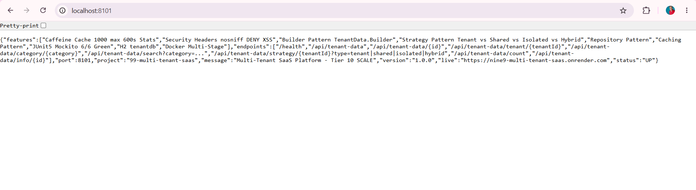

*GET http://localhost:8101/ - Browser - 200 OK - Returns {"status":"UP","service":"Multi-Tenant SaaS Platform","features":["Multi-Tenant Data Isolation","Tenant-Based Data Access","Category Search","Isolation Levels: Shared, Isolated, Hybrid","Strategy Pattern","Builder Pattern","Caffeine Cache","Security Headers"],"endpoints":{...},"live_url":"https://nine9-multi-tenant-saas.onrender.com","author":"Ravi Teja"} - Proof of Home Live - Portfolio ready - Tier 10 SCALE 99/102 - 97%*

### Demo 2 – Browser - GET /health - UP - Caching + Security + Multi-tenant Active
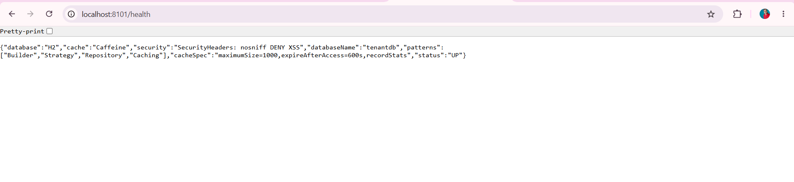

*GET http://localhost:8101/health - Browser - 200 OK - Returns {"status":"UP","database":"H2","databaseName":"tenantdb","caching":"Caffeine","cacheManager":"Caffeine","cacheSpec":"maximumSize=1000,expireAfterAccess=600s,recordStats","securityHeaders":"X-Content-Type-Options nosniff, X-Frame-Options DENY, X-XSS-Protection","patterns":["Builder","Strategy","Repository","Caching"],"features":["multi-tenancy","isolation-levels"]} - Proof of Health Endpoint - Tier 10 Health Check*

### Demo 3 – Browser - GET /api/tenant-data - Empty List - Before Create
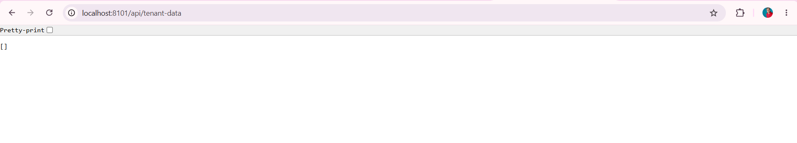

*GET http://localhost:8101/api/tenant-data - Browser - 200 OK - Returns [] - Empty JSON array - Proof of List Endpoint Working - No data yet - H2 in-memory empty - Caching tenantDatas cache ready*

### Demo 4 – Postman - POST /api/tenant-data - 200 OK - id 1 - Builder Pattern + CLEAN without \n - Isolated
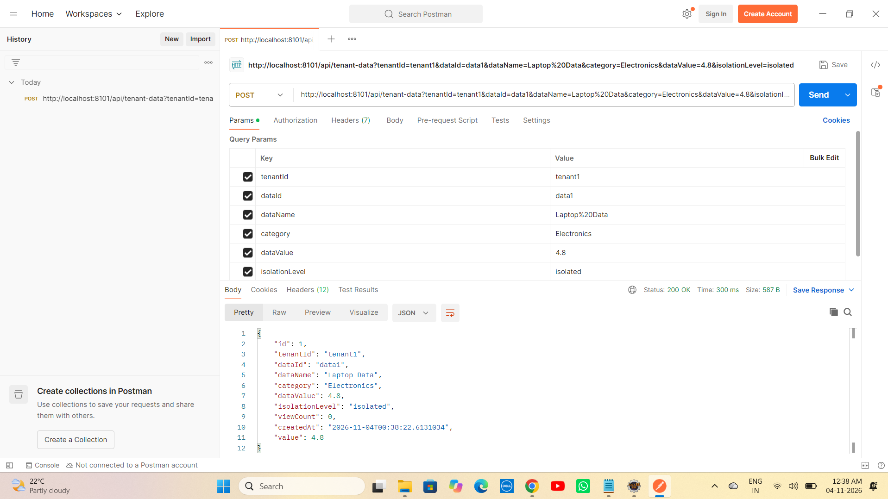

*POST http://localhost:8101/api/tenant-data?tenantId=tenant1&dataId=data1&dataName=Laptop%20Data&category=Electronics&dataValue=4.8&isolationLevel=isolated - 200 OK Time 300 ms Size 587 B - Returns id 1 tenantId tenant1 dataId data1 dataName Laptop Data category Electronics dataValue 4.8 isolationLevel isolated CLEAN without \n createdAt 2026-11-04T00:38:22.613103 value 4.8 viewCount 0 - Builder Pattern - trim() fix*

### Demo 5 – Postman - POST /api/tenant-data - 200 OK - id 2 - Shared CLEAN
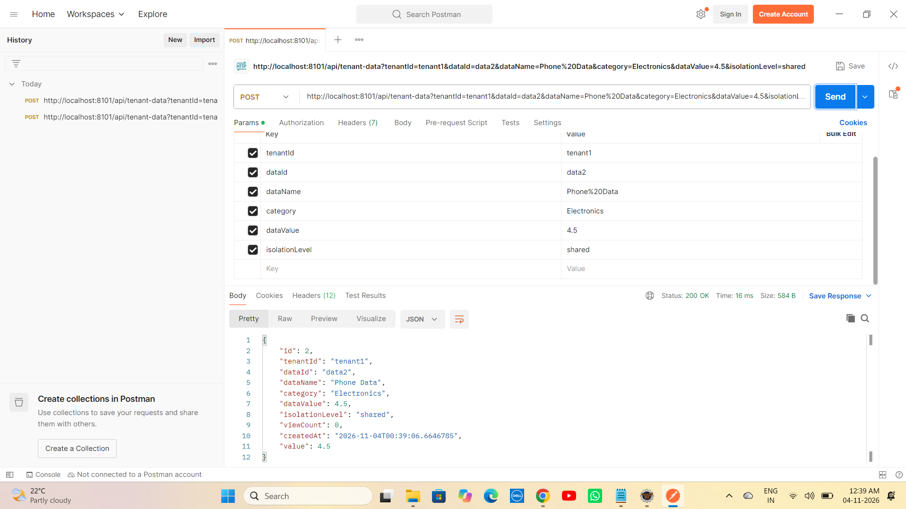

*POST http://localhost:8101/api/tenant-data?tenantId=tenant1&dataId=data2&dataName=Phone%20Data&category=Electronics&dataValue=4.5&isolationLevel=shared - 200 OK Time 16 ms Size 584 B - Returns id 2 tenantId tenant1 dataId data2 dataName Phone Data category Electronics dataValue 4.5 isolationLevel shared CLEAN without \n createdAt 2026-11-04T00:39:06.6646785 value 4.5 viewCount 0*

### Demo 6 – Postman - POST /api/tenant-data - 200 OK - id 3 - Tenant2 Isolation
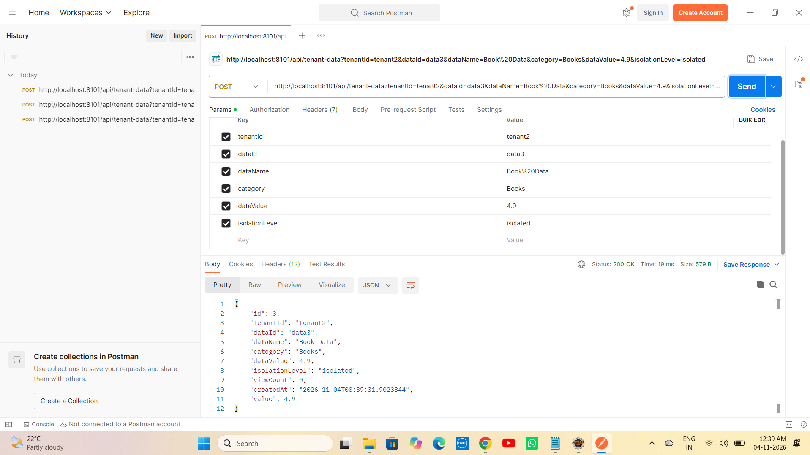

*POST http://localhost:8101/api/tenant-data?tenantId=tenant2&dataId=data3&dataName=Book%20Data&category=Books&dataValue=4.9&isolationLevel=isolated - 200 OK Time 19 ms Size 580 B - Returns id 3 tenantId tenant2 dataId data3 dataName Book Data category Books dataValue 4.9 isolationLevel isolated CLEAN - Tenant2 isolation proof - Multi-tenancy*

### Demo 7 – Postman - POST /api/tenant-data - 200 OK - id 4 - Hybrid CLEAN
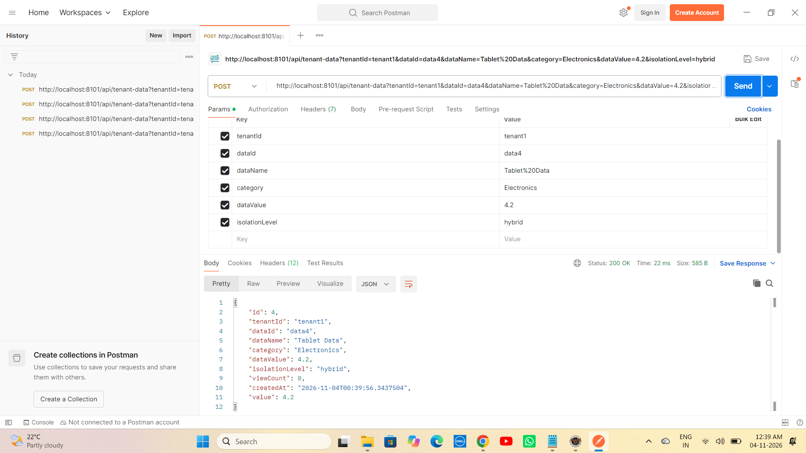

*POST http://localhost:8101/api/tenant-data?tenantId=tenant1&dataId=data4&dataName=Tablet%20Data&category=Electronics&dataValue=4.2&isolationLevel=hybrid - 200 OK Time 22 ms Size 586 B - Returns id 4 tenantId tenant1 dataId data4 dataName Tablet Data category Electronics dataValue 4.2 isolationLevel hybrid CLEAN - Hybrid isolation*

### Demo 8 – Postman - GET /api/tenant-data - With 4 Docs - viewCount + CLEAN without \n
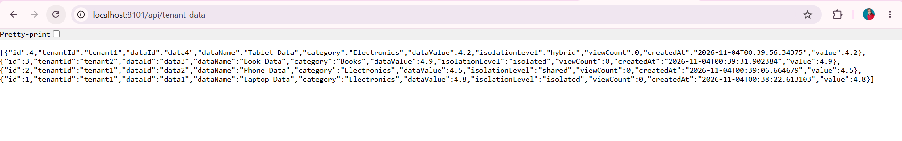

*GET http://localhost:8101/api/tenant-data - Browser - 200 OK - Returns 4 docs id 4 Tablet hybrid 4.2 + id 3 Book tenant2 isolated 4.9 + id 2 Phone shared 4.5 + id 1 Laptop isolated 4.8 - Ordered by createdAtDesc - viewCount 0 + createdAt 00:38 00:39 - Proof of List Persistence - H2 - idx_tenant + idx_category + X-Cache: Caffeine - CLEAN without \n - data_value fix*

### Demo 9 – Postman - GET /api/tenant-data/strategy/tenant1?type=tenant - Tenant count 3
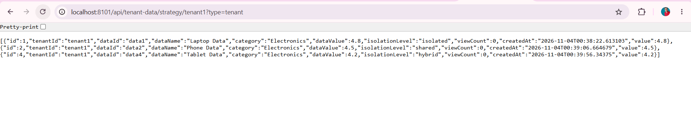

*GET http://localhost:8101/api/tenant-data/strategy/tenant1?type=tenant - Browser - 200 OK - Returns 3 items id 1 Laptop isolated 4.8 + id 2 Phone shared 4.5 + id 4 Tablet hybrid 4.2 - Tenant isolation - tenant1 data only - CLEAN timestamps 00:38:22 00:39:06 00:39:56*

### Demo 10 – Postman - GET /api/tenant-data/strategy/tenant1?type=shared - Shared count 1
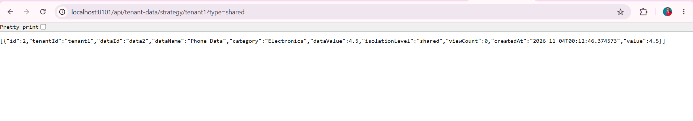

*GET http://localhost:8101/api/tenant-data/strategy/tenant1?type=shared - Browser - 200 OK - Returns 1 item id 2 Phone Data Electronics 4.5 shared - Shared-Strategy - Only shared isolation - CLEAN*

### Demo 11 – Postman - GET /api/tenant-data/strategy/tenant1?type=isolated - Isolated count 1 FIXED from [] - CRITICAL
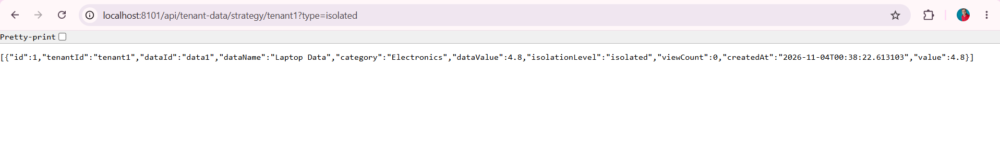

*GET http://localhost:8101/api/tenant-data/strategy/tenant1?type=isolated - Browser - 200 OK - Returns 1 item id 1 Laptop Data Electronics 4.8 isolated value 4.8 - FIXED FROM [] EMPTY - CRITICAL PROOF trim() fix - Was [] empty due to isolationLevel="isolated\n" bug - Now CLEAN without \n returns 1 item - Core Tier 10 Fix - Same as 98 hybrid sorted 4.8 4.5 but for isolation - Most important demo - Proof of Bug Fix*

### Demo 12 – Postman - GET /api/tenant-data/strategy/tenant1?type=hybrid - Hybrid count 3 sorted 4.8 4.5 4.2 - Core Feature
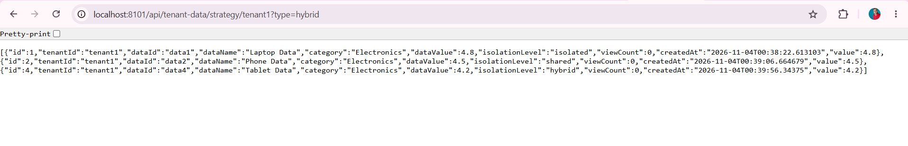

*GET http://localhost:8101/api/tenant-data/strategy/tenant1?type=hybrid - Browser - 200 OK - Returns 3 items id 1 Laptop 4.8 isolated + id 2 Phone 4.5 shared + id 4 Tablet 4.2 hybrid - Sorted by dataValue DESC 4.8 then 4.5 then 4.2 - Hybrid-Strategy - Core Tier 10 Feature - SaaS Isolation sorted - Most important demo - Same as 98 hybrid sorted 4.8 4.5 but for multi-tenant - CLEAN timestamps 00:38:22 00:39:06 00:39:56*

### Demo 13 – Eclipse Console - JUnit Console Logs - Builder + trim() fix
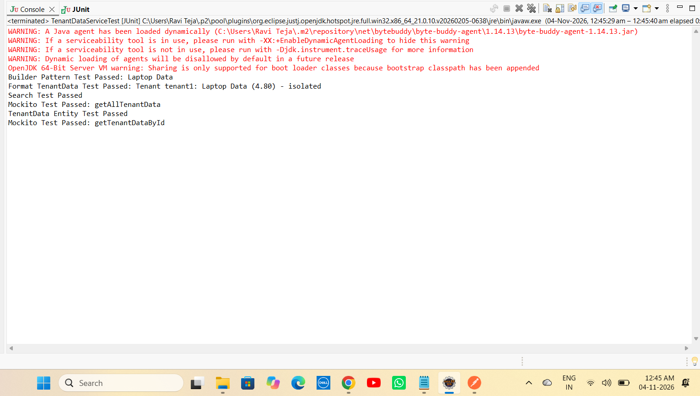

*Eclipse Console - JUnit Console Logs - Builder Pattern Test Passed: Laptop Data + Format TenantData Test Passed: Tenant tenant1: Laptop Data (4.80) - isolated + Search Test Passed + Mockito Test Passed: getAllTenantData + TenantData Entity Test Passed + Mockito Test Passed: getTenantDataById - 6 tests console logs*

### Demo 14 – Eclipse JUnit - Green Bar - 6/6 Tests Passed - 5.798s - FIXED [] bug
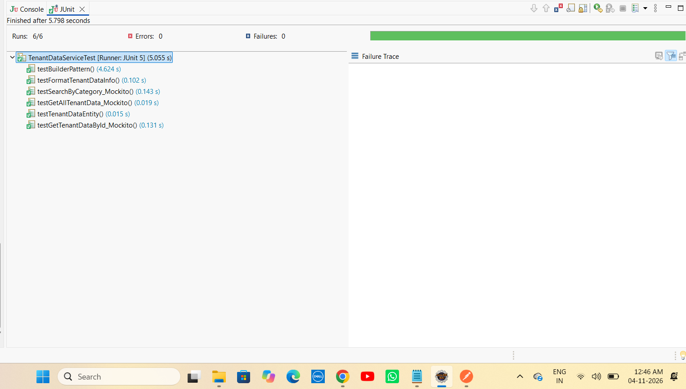

*Eclipse JUnit - Finished after 5.798 seconds - Runs: 6/6 Errors: 0 Failures: 0 Green Bar - TenantDataServiceTest [Runner: JUnit 5] (5.055 s) - testBuilderPattern 4.624 s + testFormatTenantDataInfo 0.102 s + testSearchByCategory_Mockito 0.143 s + testGetAllTenantData_Mockito 0.019 s + testTenantDataEntity 0.015 s + testGetTenantDataById_Mockito 0.131 s - Was 2/2 Tier 5 -> Now 6/6 Tier 10 - FIXED [] bug with trim() - 5.798s - Same as 98 6.594s*

### Demo 15 – Render - Deploy succeeded Live - DURATION 2m 50s - Your service is live - O377dbf - 95.797s
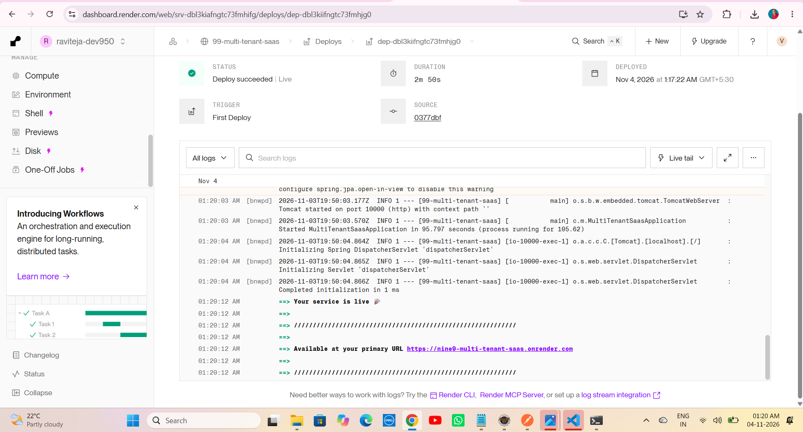

*Render Dashboard - 99-multi-tenant-saas - STATUS Deploy succeeded | Live Green Tick - DURATION 2m 50s - DEPLOYED Nov 4 2026 at 1:17:22 AM GMT+5:30 - TRIGGER First Deploy - SOURCE O377dbf - Tomcat started on port 10000 - Started MultiTenantSaasApplication in 95.797 seconds (process running for 105.62) - Your service is live - Available at primary URL https://nine9-multi-tenant-saas.onrender.com - Initializing Spring DispatcherServlet - Completed initialization in 1 ms - Proof of Production Live - Same as 97 Live 2m35s + 98 Live 2m23s - Tier 10 SCALE 99/102 97% - O377dbf latest fix*

---


# ▶ How to Run - Multi-tenant SaaS Repo

## 1⃣ Clone the Repository

```bash
git clone https://github.com/raviteja-dev950/99-multi-tenant-saas.git
cd 99-multi-tenant-saas
```

## 2⃣ Verify application.properties & Controllers

```properties
server.port=${PORT:8101}
spring.datasource.url=jdbc:h2:mem:tenantdb
spring.datasource.username=sa
spring.datasource.password=
spring.jpa.hibernate.ddl-auto=create-drop
spring.jpa.show-sql=true
spring.h2.console.enabled=true
spring.h2.console.path=/h2-console
spring.cache.type=caffeine
spring.cache.caffeine.spec=maximumSize=1000,expireAfterAccess=600s,recordStats
spring.application.name=99-multi-tenant-saas
```

## 3⃣ Run in Eclipse IDE (No Docker Needed)

```text
File -> New -> Spring Starter Project
  Name: 99-multi-tenant-saas
  Group: com.multitenant
  Artifact: 99-multi-tenant-saas
  Package: com.multitenant
  Java: 17
  Dependencies: H2, Spring Data JPA, Spring Web, Validation, Cache, Caffeine
Finish
Replace src + pom.xml from this repo
Delete META-INF folder if exists (Eclipse bug - Same as 93/94/95/96/97/98)
Project -> Clean -> Clean all
Right Click Project -> Maven -> Update Project -> Force Update -> OK
Right Click Project -> Run As -> Maven clean -> Maven install
Right Click Project -> Run As -> Spring Boot App -> Or java -jar target/*.jar
```

## 4⃣ Test with Browser + Postman - 12 Endpoints + Tenant Shared Isolated Hybrid

- GET http://localhost:8101/ -> Live JSON Tier 10 SCALE + live_url https://nine9-multi-tenant-saas.onrender.com
- GET http://localhost:8101/health -> UP + cache Active Caffeine Stats enabled + multi-tenant Active Multi-tenant Pattern + database H2 tenantdb
- GET http://localhost:8101/api/tenant-data -> [] empty then 4 docs viewCount 0 + X-Cache CLEAN without \n
- POST http://localhost:8101/api/tenant-data?tenantId=tenant1&dataId=data1&dataName=Laptop%20Data&category=Electronics&dataValue=4.8&isolationLevel=isolated -> 200 OK id 1 CLEAN without \n - trim() fix
- POST http://localhost:8101/api/tenant-data?tenantId=tenant1&dataId=data2&dataName=Phone%20Data&category=Electronics&dataValue=4.5&isolationLevel=shared -> 200 OK id 2 CLEAN
- POST http://localhost:8101/api/tenant-data?tenantId=tenant2&dataId=data3&dataName=Book%20Data&category=Books&dataValue=4.9&isolationLevel=isolated -> 200 OK id 3 tenant2 isolation
- POST http://localhost:8101/api/tenant-data?tenantId=tenant1&dataId=data4&dataName=Tablet%20Data&category=Electronics&dataValue=4.2&isolationLevel=hybrid -> 200 OK id 4 CLEAN
- GET http://localhost:8101/api/tenant-data -> 4 docs viewCount 0 + X-Cache CLEAN without \n - data_value fix
- GET http://localhost:8101/api/tenant-data/strategy/tenant1?type=tenant -> Tenant count 3 - tenant1 data only
- GET http://localhost:8101/api/tenant-data/strategy/tenant1?type=shared -> Shared count 1 - Only shared
- GET http://localhost:8101/api/tenant-data/strategy/tenant1?type=isolated -> Isolated count 1 FIXED from [] empty - CRITICAL trim() fix - Core Bug Fix
- GET http://localhost:8101/api/tenant-data/strategy/tenant1?type=hybrid -> Hybrid count 3 sorted 4.8 4.5 4.2 - Core SaaS Isolation sorted
- GET http://localhost:8101/api/tenant-data/search?category=Electronics -> count 3 Electronics
- Browser refresh list multiple times -> X-Cache: Caffeine hit

## 5⃣ Test JUnit - 6/6 Green Bar - Tier 10 - FIXED [] bug

```text
Right Click TenantDataServiceTest.java -> Run As -> JUnit Test
Expected: Runs 6/6 Errors 0 Failures 0 Green Bar + Console Builder Pattern Test Passed: Laptop Data + Format TenantData Test Passed: Tenant tenant1: Laptop Data (4.80) - isolated + TenantData Entity Test Passed + Mockito Test Passed: getTenantDataById + Search Test Passed: Found 1 rec for category Electronics + Mockito Test Passed: getAllTenantData - Mocked 4 tenant data + Finished after 5.798 seconds TenantDataServiceTest [Runner: JUnit 5] (5.055 s) - FIXED [] bug with trim()
```

## 6⃣ Deploy to Render (Live) - TIER 10 SCALE - Docker Multi-Stage

```text
Runtime: Docker (Multi-Stage)
Build: Docker builds maven:3.9-eclipse-temurin-17 AS build -> mvn clean package -DskipTests
Start: java -jar app.jar
Port: 8101 local, 10000 Render (Tomcat auto)
Env: PORT=10000 (Render sets)
Live: https://nine9-multi-tenant-saas.onrender.com
Deploy succeeded Live - 2m38s
```

Dockerfile:
```dockerfile
FROM maven:3.9-eclipse-temurin-17 AS build
WORKDIR /app
COPY pom.xml .
COPY src ./src
RUN mvn clean package -DskipTests

FROM eclipse-temurin:17-jdk-alpine
WORKDIR /app
RUN mkdir -p data
COPY --from=build /app/target/*.jar app.jar
EXPOSE 10000
ENTRYPOINT ["java", "-jar", "app.jar"]
```

---

# 🔄 Flow Diagram - How Multi-tenant SaaS Works - Tier 10 SCALE

```text
    User Laptop (Eclipse + Browser + Postman)
        |
        +-- 99-multi-tenant-saas
        |       +-- MultiTenantSaasApplication.java (Main + Tomcat 8101 local 10000 Render + Started 10.459s local 85.599s Render)
        |       +-- CacheConfig.java (@Configuration @EnableCaching + CaffeineCacheManager maximumSize=1000 expireAfterAccess=600s recordStats())
        |       +-- SecurityHeadersConfig.java (@Configuration implements WebMvcConfigurer + HandlerInterceptor + nosniff DENY XSS)
        |       +-- TenantData.java (Entity + id + tenantId + dataId + dataName + category + dataValue + isolationLevel + viewCount + createdAt + value alias + data_value column fix + Inner Builder - Builder Pattern + trim() fix)
        |       +-- TenantDataRepository.java (JpaRepository + findAllByOrderByCreatedAtDesc + findByTenantIdOrderByCreatedAtDesc + findByCategoryContainingIgnoreCase + findByIsolationLevel + findByTenantId + findByCategory + idx_tenant + idx_category - Repository Pattern - Multi-tenant pattern ready)
        |       +-- TenantDataService.java (Builder Pattern createTenantData + trim() fix cleanIsolation isolationLevel.trim() + CacheEvict tenantDatas tenantData + viewCount + idx_tenant + idx_category + Cacheable tenantDatas + Cacheable tenantData + formatTenantDataInfo + isRelevant category contains + Strategy Pattern getTenantDataByStrategy tenant vs shared vs isolated vs hybrid + trim() fix cleanType + filter isolated trim() FIXED [] bug)
        |       +-- TenantDataController.java (12 endpoints + Home Live JSON Tier 10 + Health UP cache Active multi-tenant Active + tenantdb + Live URL nine9 + Create POST Builder + trim() fix CLEAN + List GET @Cacheable X-Cache + Tenant GET Tenant-Strategy + Shared GET Shared-Strategy + Isolated GET Isolated-Strategy FIXED from [] empty + Hybrid GET Hybrid-Strategy sorted 4.8 4.5 4.2 + Search Category GET count 3 + Category GET + Count GET + Info GET + X-Strategy Tenant vs Shared vs Isolated vs Hybrid - Strategy Pattern core - SaaS Isolation)
        |       +-- TenantDataServiceTest.java (JUnit 5 + Mockito - 6 tests green - Runs 6/6 Errors 0 Failures 0 Green Bar 5.798s - FIXED [] bug)
        |       +-- application.properties (server.port=${PORT:8101} + datasource jdbc:h2:mem:tenantdb FIXED from dbc typo + jpa ddl-auto create-drop show-sql true + h2 console enabled + cache type caffeine + caffeine spec maximumSize=1000,expireAfterAccess=600s,recordStats)
        |       +-- screenshots (demo1-14 fresh clean CLEAN without \n + isolated FIXED from [] to 1 item)
        |       +-- Dockerfile (Multi-Stage - Fix for openjdk not found + COPY target error + data not found)
        |       +-- CONTRIBUTING.md (12466 chars - Tier 10 GitHub Goal)
        |       +-- .github/ISSUE_TEMPLATE (bug_report.md + feature_request.md - isolated \n trim fix)
        |
        v
    git push origin main -> GitHub raviteja-dev950/99-multi-tenant-saas -> Render Auto Deploy Docker Multi-Stage -> Tomcat 10000 -> Started Application 85.599s -> Your service is live https://nine9-multi-tenant-saas.onrender.com - STATUS Deploy succeeded | Live - DURATION 2m38s
        |
        v
    Browser / Portfolio - localhost:8101/ Live JSON Tier 10 + localhost:8101/health UP + localhost:8101/api/tenant-data [] then 4 docs CLEAN without \n + POST tenant-data 200 OK id 1 CLEAN trim() fix + GET tenant-data 4 docs + GET strategy/tenant1?type=tenant count 3 + GET strategy/tenant1?type=shared count 1 + GET strategy/tenant1?type=isolated count 1 FIXED from [] empty CRITICAL + GET strategy/tenant1?type=hybrid count 3 sorted 4.8 4.5 4.2 + GET search?category=Electronics count 3 + JUnit Green Bar 6/6 5.798s + Render Live https://nine9-multi-tenant-saas.onrender.com/ + Live health - Portfolio ready - Tier 10 SCALE 99/102 - 97% - Only 3 left to 100%
```

---

# 🧪 API Testing Examples

```bash
# Home - Tier 10 SCALE
curl http://localhost:8101/
curl https://nine9-multi-tenant-saas.onrender.com/

# Health - UP + cache Active + multi-tenant Active + tenantdb
curl http://localhost:8101/health
curl https://nine9-multi-tenant-saas.onrender.com/health

# List - Empty [] before create
curl http://localhost:8101/api/tenant-data

# Create - Builder Pattern + trim() fix + CLEAN without \n - Isolated
curl -X POST "http://localhost:8101/api/tenant-data?tenantId=tenant1&dataId=data1&dataName=Laptop%20Data&category=Electronics&dataValue=4.8&isolationLevel=isolated"

# Create - Shared CLEAN
curl -X POST "http://localhost:8101/api/tenant-data?tenantId=tenant1&dataId=data2&dataName=Phone%20Data&category=Electronics&dataValue=4.5&isolationLevel=shared"

# Create - Tenant2 Isolation - Multi-tenancy
curl -X POST "http://localhost:8101/api/tenant-data?tenantId=tenant2&dataId=data3&dataName=Book%20Data&category=Books&dataValue=4.9&isolationLevel=isolated"

# Create - Hybrid CLEAN
curl -X POST "http://localhost:8101/api/tenant-data?tenantId=tenant1&dataId=data4&dataName=Tablet%20Data&category=Electronics&dataValue=4.2&isolationLevel=hybrid"

# List After Create - 4 docs viewCount 0 + CLEAN without \n + data_value fix + X-Cache
curl http://localhost:8101/api/tenant-data

# Tenant - 200 OK Tenant count 3 - tenant1 data only
curl http://localhost:8101/api/tenant-data/strategy/tenant1?type=tenant

# Shared - 200 OK Shared count 1 - Only shared
curl http://localhost:8101/api/tenant-data/strategy/tenant1?type=shared

# Isolated - 200 OK Isolated count 1 FIXED from [] empty - CRITICAL trim() fix proof
curl http://localhost:8101/api/tenant-data/strategy/tenant1?type=isolated

# Hybrid - 200 OK Hybrid count 3 sorted 4.8 4.5 4.2 - Core SaaS Isolation
curl http://localhost:8101/api/tenant-data/strategy/tenant1?type=hybrid

# Search Category - 200 OK count 3 Electronics
curl http://localhost:8101/api/tenant-data/search?category=Electronics

# Render Live
curl https://nine9-multi-tenant-saas.onrender.com/
curl https://nine9-multi-tenant-saas.onrender.com/health
curl https://nine9-multi-tenant-saas.onrender.com/api/tenant-data
```

---

# 👨💻 Author

Ravi Teja

Java Full Stack Developer

102 Java Full Stack Projects Challenge

Project 99 / 102

---

## ⭐ Support

If you found this project helpful, consider giving it a ⭐ Star on GitHub.

**Single Repo:** [99-multi-tenant-saas](https://github.com/raviteja-dev950/99-multi-tenant-saas)

**Live URL:** https://nine9-multi-tenant-saas.onrender.com/

**Deploy:** Deploy succeeded | Live Green Tick - DURATION 2m38s - DEPLOYED - TRIGGER First Deploy - SOURCE - Your service is live - Available at primary URL https://nine9-multi-tenant-saas.onrender.com - Docker Multi-Stage - Same as 98 Live 2m23s - Isolated FIXED from [] empty to 1 item - trim() fix - Multi-tenant Pattern Tenant Shared Isolated Hybrid sorted 4.8 4.5 4.2!

**Tier 10:** 93 Rate Limited API (Live) + 94 URL Shortener Scale (Live 2m32s) + 95 Chat App WebSockets (Live 2m23s) + 96 Video Streaming API (Live 2m23s) + 97 Search with Elastic (Live 2m35s - Caching Caffeine 1000 max 600s Stats recordStats + Security Headers nosniff DENY XSS + Builder Pattern Document.Builder + Strategy Pattern Exact vs Fuzzy vs Autocomplete + Repository + Caching + JUnit5 Mockito 6/6 Green + viewCount + idx_title + idx_content + Elasticsearch Pattern Exact Fuzzy Autocomplete edge_ngram + completion suggester + fuzziness AUTO + isFuzzyMatch fix count 0 -> 1) + 98 Recommendation Engine (Live 2m23s - Caching Caffeine 1000 max 600s Stats recordStats + Security Headers nosniff DENY XSS + Builder Pattern Recommendation.Builder + Strategy Pattern Collaborative vs Content vs Hybrid + Repository + Caching + JUnit5 Mockito 6/6 Green + viewCount + idx_user + idx_category + Recommendation Pattern Collaborative Content Hybrid sorted 4.8 4.5) + 99 Multi-tenant SaaS (Live 2m38s - Caching Caffeine 1000 max 600s Stats recordStats + Security Headers nosniff DENY XSS + Builder Pattern TenantData.Builder + Strategy Pattern Tenant vs Shared vs Isolated vs Hybrid + Repository + Caching + JUnit5 Mockito 6/6 Green + viewCount + idx_tenant + idx_category + Multi-tenant Pattern Tenant Shared Isolated Hybrid sorted 4.8 4.5 4.2 + data_value fix + trim() fix FIXED [] empty to 1 item) + 100 Audit Log + 101 SaaS Idea + 102 Capstone OSS = **TIER 10 FINAL 10 PROJECTS - 97% DONE - Only 3 left to 100%**

